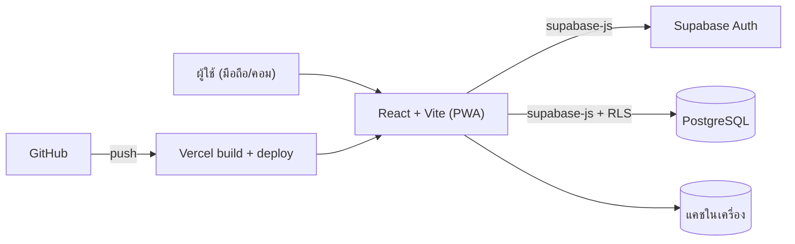
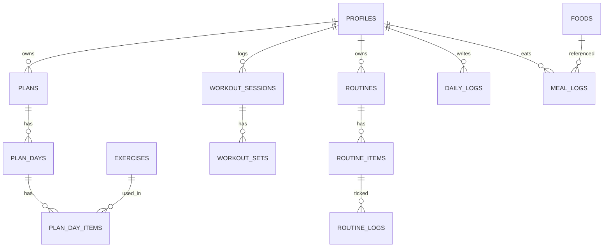

# 🔥 ลุยดิวะ!

> แอปวางแผนออกกำลังกาย + กิจวัตรประจำวัน สำหรับคนที่รู้ว่าต้องเริ่มแล้ว แต่ยังหาแรงไม่เจอ
> **ไม่ต้องมีอุปกรณ์ · ไม่ต้องมีข้ออ้าง · เปิดมือถือแล้วลุยได้เลย**

**สถานะโปรเจกต์:** 📝 ระยะวางแผน (Planning) ยังไม่มีโค้ดแอปเต็มรูปแบบ ไฟล์นี้คือแผนงานและคู่มือเริ่มต้น
ต้นแบบหน้าเดียว (Prototype ที่เป็นไฟล์ HTML) มีตารางซ้อม 7 วัน แอนิเมชันท่า ตารางอาหาร และบันทึกประจำวันแล้ว ลุยดิวะ! คือการต่อยอดต้นแบบนั้นให้เป็นแอปจริง

---

## สารบัญ

1. [ลุยดิวะ! คืออะไร](#1-ลุยดิวะ-คืออะไร)
2. [ฟีเจอร์](#2-ฟีเจอร์)
3. [Tech Stack](#3-tech-stack)
   - [3.1 ขีดจำกัดของแพ็กเกจฟรีและวิธีรับมือ](#31-ขีดจำกัดของแพ็กเกจฟรีและวิธีรับมือ)
4. [สถาปัตยกรรมและโครงสร้างโปรเจกต์](#4-สถาปัตยกรรมและโครงสร้างโปรเจกต์)
5. [โครงสร้างฐานข้อมูล](#5-โครงสร้างฐานข้อมูล)
6. [การติดตั้ง](#6-การติดตั้ง)
7. [Deploy](#7-deploy)
8. [ความปลอดภัยและความเป็นส่วนตัว](#8-ความปลอดภัยและความเป็นส่วนตัว)
9. [Roadmap](#9-roadmap)
10. [การทดสอบและการทำงานร่วมกัน](#10-การทดสอบและการทำงานร่วมกัน)
11. [แก้ปัญหาที่เจอบ่อย](#11-แก้ปัญหาที่เจอบ่อย)
12. [ศัพท์เทคนิคที่ใช้ในเอกสารนี้](#12-ศัพท์เทคนิคที่ใช้ในเอกสารนี้)
13. [คำเตือนด้านสุขภาพ](#13-คำเตือนด้านสุขภาพ)
14. [License](#14-license)

---

## 1. ลุยดิวะ! คืออะไร

### ปัญหาที่แอปแก้

- แผนออกกำลังกายส่วนใหญ่หนักเกินไปสำหรับคนเริ่มต้น ทำได้สามวันแล้วเลิก
- แผนที่ดีมักต้องมีอุปกรณ์หรือยิม
- ข้อมูลกระจัดกระจาย: ท่าอยู่ในคลิป ตัวเลขอาหารอยู่ในหัว น้ำหนักอยู่ในโน้ต
- ไม่มีที่ย้อนดูว่า "เดือนนี้ทำไปเท่าไหร่" ติ๊กเสร็จวันนี้ พรุ่งนี้ก็หายหมด

### หลักการออกแบบ

| หลักการ | ความหมาย |
|---|---|
| **Bodyweight first** | ท่าตั้งต้นทั้งหมดใช้น้ำหนักตัว ไม่ต้องมีอุปกรณ์ |
| **Mobile first** | ออกแบบสำหรับจอมือถือก่อน ใช้ได้ด้วยนิ้วโป้งข้างเดียว |
| **ภาษาไทยเป็นหลัก** | ข้อความ เมนูอาหาร และน้ำเสียงเป็นไทย ศัพท์เทคนิคใส่ภาษาอังกฤษกำกับ |
| **เริ่มเล็กได้** | มีโหมด "วันนี้ไม่ไหว" ลดแผนเหลือเวอร์ชัน 5 นาที ดีกว่าไม่ทำเลย |
| **ข้อมูลเป็นของผู้ใช้** | ส่งออก ลบได้ ไม่ขายข้อมูล |
| **ตัวเลขต้องบอกที่มา** | ค่าแคลอรี่/โปรตีนที่เป็นการประมาณจะมีป้าย "ประมาณการ" เสมอ |

---

## 2. ฟีเจอร์

### 🟢 MVP (เวอร์ชันแรกที่ใช้งานได้จริง)

- **สมัคร/เข้าสู่ระบบ** ด้วยลิงก์ทางอีเมล (Magic link) ไม่ต้องจำรหัสผ่าน
- **แผนรายสัปดาห์** มีแผนตั้งต้น "ไม่ใช้อุปกรณ์ 4 วัน" แก้ไขได้ (เพิ่ม/ลบ/สลับท่า ปรับเซตและจำนวนครั้ง)
- **คลังท่าออกกำลังกาย** พร้อมแอนิเมชันคนแท่ง และเพิ่มท่าของตัวเองได้
- **เช็กลิสต์ประจำวัน** ติ๊กท่าที่ทำเสร็จ บันทึกเซต/ครั้งจริง และความหนักที่รู้สึก (RPE 1–10)
- **กิจวัตรตื่นนอน** ชุดท่าเบาๆ ปลุกร่างกาย (ต่างจากวอร์มอัพก่อนซ้อม)
- **บันทึกรายวัน** น้ำหนัก, kcal, โปรตีน, น้ำดื่ม, ชั่วโมงนอน, อารมณ์, โน้ต
- **ประวัติและสรุปรายสัปดาห์** กราฟน้ำหนัก/โปรตีน และจำนวนวันที่ซ้อม

### 🟡 v1.0 (ทำให้ครบเครื่อง)

- **กิจวัตรกำหนดเอง (Routine)** ไม่จำกัดแค่ออกกำลังกาย เช่น กินวิตามิน, ดื่มน้ำ, อ่านหนังสือ 15 นาที, ทบทวนบทเรียน เลือกวันที่ทำซ้ำ ตั้งเวลาเตือน
- **Streak และสรุปสัปดาห์** นับวันต่อเนื่อง พร้อมข้อความให้กำลังใจ (ปิดได้)
- **โหมดซ้อม** แสดงทีละท่าเต็มจอ พร้อมตัวจับเวลาพัก และตัวนับเวลา Plank/Wall sit
- **ตัวช่วยตั้งเป้าหมาย** คำนวณพลังงานและโปรตีนโดยประมาณจากสูตรมาตรฐาน (เช่น Mifflin–St Jeor) ติดป้ายว่าเป็นค่าประมาณ
- **คลังอาหารไทย** เมนูตามสั่ง/ร้านสะดวกซื้อ พร้อมฟอร์มเพิ่มอาหารจากฉลากจริง และบันทึกมื้อ
- **PWA** ติดตั้งลงหน้าจอโฮม ใช้งานพื้นฐานแบบออฟไลน์ได้
- **แจ้งเตือน (Web Push)** บน iPhone ต้องเพิ่มแอปลงหน้าจอโฮมก่อน (iOS 16.4 ขึ้นไป) ถึงจะรับแจ้งเตือนได้
- **Dark mode**, ส่งออกข้อมูล CSV/JSON, ลบบัญชีและข้อมูลทั้งหมด

### 🔵 v2 (ไอเดียต่อยอด)

- แนะนำเพิ่มความหนักอัตโนมัติ (Progressive overload) จากประวัติ
- รูปความก้าวหน้า เก็บใน Supabase Storage แบบ private
- การ์ดสรุปสัปดาห์เป็นรูปสำหรับแชร์
- เพื่อนช่วยกันลุย (Streak กลุ่ม)
- AI Coach สรุปสัปดาห์และแนะนำปรับแผน เรียกผ่าน Edge Function ฝั่งเซิร์ฟเวอร์ **ห้ามใส่ API key ในโค้ดหน้าเว็บ**

---

## 3. Tech Stack

| ส่วน | เทคโนโลยี | ทำไมเลือก |
|---|---|---|
| Frontend (หน้าเว็บ) | **React** + **Vite** (JavaScript) | เรียนรู้ง่าย ชุมชนใหญ่ เริ่มต้นเร็ว |
| จัดหน้าตา | **Tailwind CSS** v4 | เขียนสไตล์ในโค้ดเดียว ทำ Mobile first และ Dark mode ง่าย |
| Routing | **React Router** | สลับหน้าโดยไม่โหลดใหม่ (SPA) |
| กราฟ | **Recharts** | กราฟบน React ใช้ง่าย |
| แอนิเมชันท่า | **SVG คนแท่ง** (ยกมาจากต้นแบบ) | เบา ไม่ต้องโหลดวิดีโอ สีเปลี่ยนตามธีมได้ |
| Backend | **Supabase** (BaaS) | ได้ฐานข้อมูล PostgreSQL + ระบบสมัครสมาชิก + RLS โดยไม่ต้องเขียนเซิร์ฟเวอร์เอง |
| PWA | **vite-plugin-pwa** | ทำให้ติดตั้งลงมือถือและแคชไฟล์ได้ |
| Deploy | **Vercel** | ผูก GitHub แล้ว push = deploy อัตโนมัติ แพ็กเกจฟรีเพียงพอสำหรับเริ่มต้น |
| ทดสอบ | **Vitest** | ทดสอบฟังก์ชันคำนวณ (TDEE, Streak) |
| คุณภาพโค้ด | **ESLint** | เตือนข้อผิดพลาดตอนเขียน (มากับเทมเพลต Vite) |

> **หมายเหตุ:** เลือกชุดนี้เพราะมือใหม่ได้ครบทั้งหน้าบ้านและหลังบ้านโดยไม่ต้องดูแลเซิร์ฟเวอร์เอง ถ้าอนาคตอยากย้ายไป TypeScript หรือ Next.js ก็ทำได้ทีหลัง โครงข้อมูลไม่ต้องเปลี่ยน

### 3.1 ขีดจำกัดของแพ็กเกจฟรีและวิธีรับมือ

ตัวเลขด้านล่างรวบรวมจากแหล่งข้อมูลปี 2026 (ฉบับล่าสุดที่ตรวจคือ ก.ย. 2026) **Supabase ปรับโควตามาแล้วหลายครั้ง ให้เช็กกับ [supabase.com/pricing](https://supabase.com/pricing) ก่อนตัดสินใจเสมอ**

| ทรัพยากร | แพ็กเกจฟรี | ผลต่อลุยดิวะ! |
|---|---|---|
| ฐานข้อมูล | 500 MB | ข้อมูลเป็นข้อความและตัวเลขล้วน คาดว่าตกหลักไม่กี่ MB ต่อคนต่อปี (ประมาณการหยาบ) เหลือเฟือสำหรับ MVP |
| ผู้ใช้ที่ active ต่อเดือน (MAU) | 50,000 | เกินความจำเป็นของช่วงเริ่มต้น |
| โปรเจกต์ที่ใช้งานพร้อมกัน | 2 | **นับรวมโปรเจกต์ Supabase อื่นที่มีอยู่แล้วด้วย** ถ้าใช้ครบ 2 จะไม่เหลือที่แยกโปรเจกต์ทดลอง (dev) |
| Egress (ข้อมูลที่ส่งออกจากเซิร์ฟเวอร์) | 5 GB | ปกติไม่ถึง ยกเว้นดึงข้อมูลเกินจำเป็น |
| พื้นที่เก็บไฟล์ | ประมาณ 500 MB–1 GB (แหล่งข้อมูลไม่ตรงกัน) | กระทบเฉพาะฟีเจอร์รูปความก้าวหน้าใน v2 |
| **พักโปรเจกต์อัตโนมัติ** | **หลังไม่มีการใช้งาน 7 วัน** | **ข้อจำกัดที่กระทบมากที่สุด** |

แพ็กเกจ Pro (ราว $25/เดือน) เพิ่มฐานข้อมูลเป็น 8 GB และไม่พักโปรเจกต์

#### วิธีรับมือ

**1) โปรเจกต์ถูกพัก**
- ใช้งานแอปอย่างน้อยสัปดาห์ละครั้งก็ไม่โดนพัก
- ถ้าถูกพักไปแล้ว เข้า Supabase Dashboard แล้วกดกู้คืนโปรเจกต์ (Restore)
- ตัวเลือกเสริมที่ชุมชนนิยมใช้ คือให้ GitHub Actions ยิงคำสั่งอ่านข้อมูลเบาๆ สัปดาห์ละ 2 ครั้ง สร้างไฟล์ `.github/workflows/keep-alive.yml`:

```yaml
name: keep-supabase-awake
on:
  schedule:
    - cron: '0 3 * * 1,4'   # จันทร์และพฤหัส เวลา 03:00 UTC
  workflow_dispatch:
jobs:
  ping:
    runs-on: ubuntu-latest
    steps:
      - name: อ่านข้อมูลท่าตั้งต้น 1 แถว
        env:
          SUPABASE_URL: ${{ secrets.SUPABASE_URL }}
          SUPABASE_KEY: ${{ secrets.SUPABASE_ANON_KEY }}
        run: |
          curl -fsS "$SUPABASE_URL/rest/v1/exercises?select=id&limit=1" \
            -H "apikey: $SUPABASE_KEY" \
            -H "Authorization: Bearer $SUPABASE_KEY"
```

ตั้งค่า `SUPABASE_URL` และ `SUPABASE_ANON_KEY` ที่ repo → Settings → Secrets and variables → Actions

> ⚠️ **ข้อควรรู้:** วิธีนี้เป็นทางลัดไม่ใช่ฟีเจอร์ทางการ ยังไม่ได้ยืนยันว่า Supabase นับคำขอแบบนี้เป็น "การใช้งาน" และ GitHub อาจปิดงานตั้งเวลาอัตโนมัติถ้า repo ไม่มีความเคลื่อนไหวนาน ถ้าแอปเริ่มมีผู้ใช้จริง ให้อัปเกรด Pro แทนการพึ่งทางลัด

**2) ข้อมูลหาย/ไม่มีที่สำรอง**
- แพ็กเกจฟรีไม่ควรถือว่ามีระบบสำรองข้อมูลอัตโนมัติ ให้เช็กหน้า Database → Backups ใน Dashboard ว่าโปรเจกต์ของคุณมีอะไรให้ใช้
- ฟีเจอร์ **ส่งออกข้อมูล CSV/JSON** (v1.0) คือแผนสำรองหลัก แนะนำให้กดส่งออกทุกเดือน

**3) ประหยัดโควตา**
- ตอนดึงข้อมูลให้เลือกเฉพาะคอลัมน์ที่ใช้ (`select('log_date, kcal')` แทน `select('*')`) และจำกัดช่วงวันที่ (เช่น 30 วันล่าสุด)
- รูปความก้าวหน้า (v2) ย่อและบีบอัดในหน้าเว็บก่อนอัปโหลด
- โน้ตและข้อความยาวๆ จำกัดความยาวไว้

**4) ทางหนีทีไล่ (ย้ายค่ายได้ไหม)**
- ฐานข้อมูลเป็น PostgreSQL มาตรฐาน ย้ายออกได้ แต่ `schema.sql` อ้างถึง `auth.users` และ `auth.uid()` ที่เป็นของ Supabase ถ้าย้ายต้องปรับส่วนระบบสมัครสมาชิกและ RLS

#### ควรอัปเกรดเป็น Pro เมื่อ

- เปิดให้คนอื่นใช้งานจริง และไม่ยอมให้แอปหายไปเฉยๆ เพราะถูกพัก
- ต้องการระบบสำรองข้อมูลอัตโนมัติ
- ฐานข้อมูลใกล้ 400 MB หรือเริ่มมีผู้ใช้หลักหมื่น

---

## 4. สถาปัตยกรรมและโครงสร้างโปรเจกต์



### โครงสร้างโฟลเดอร์ (เป้าหมาย)

```
luydiwa/
├─ public/                 ไอคอนแอป, manifest
├─ src/
│  ├─ app/                 router, providers (auth, theme)
│  ├─ features/
│  │  ├─ auth/             หน้าเข้าสู่ระบบ
│  │  ├─ plans/            แผนรายสัปดาห์ + แก้ไขแผน
│  │  ├─ workout/          เช็กลิสต์/โหมดซ้อม/ตัวจับเวลา
│  │  ├─ routine/          กิจวัตรตื่นนอน + กิจวัตรกำหนดเอง
│  │  ├─ nutrition/        คลังอาหาร + บันทึกมื้อ
│  │  ├─ log/              บันทึกรายวัน + ประวัติ
│  │  ├─ progress/         กราฟ + สรุปสัปดาห์ + streak
│  │  └─ settings/         เป้าหมาย, ธีม, ส่งออก/ลบข้อมูล
│  ├─ components/          ปุ่ม การ์ด StickFigure (แอนิเมชันท่า)
│  ├─ lib/                 supabase.js, date.js, calc.js (TDEE ฯลฯ)
│  ├─ data/                poses.js (ท่าคนแท่ง), foods.seed.json
│  └─ main.jsx
├─ supabase/
│  └─ schema.sql           สร้างตาราง + RLS + ข้อมูลท่าตั้งต้น
├─ .env.example
├─ vercel.json
└─ README.md
```

---

## 5. โครงสร้างฐานข้อมูล

ไฟล์เต็มอยู่ที่ [`supabase/schema.sql`](supabase/schema.sql) (13 ตาราง + RLS + ท่าตั้งต้น 19 ท่า)



| ตาราง | เก็บอะไร |
|---|---|
| `profiles` | ชื่อ ส่วนสูง เป้าหมาย (kcal/โปรตีน/น้ำ) สร้างอัตโนมัติตอนสมัคร |
| `exercises` | คลังท่า (ของระบบ + ของผู้ใช้เอง) พร้อม `anim` ชี้ไปที่ชุดแอนิเมชัน |
| `plans`, `plan_days`, `plan_day_items` | แผน → วันในสัปดาห์ (1=จันทร์ ... 7=อาทิตย์) → ท่าในแต่ละวัน |
| `workout_sessions`, `workout_sets` | ประวัติการซ้อมจริง รายเซต |
| `routines`, `routine_items`, `routine_logs` | กิจวัตร รายการในกิจวัตร และการติ๊กรายวัน |
| `daily_logs` | น้ำหนัก kcal โปรตีน น้ำ การนอน อารมณ์ โน้ต (1 แถวต่อวัน) |
| `foods`, `meal_logs` | คลังอาหาร และบันทึกมื้อ |

**ทุกตารางเปิด RLS** (ดูหัวข้อความปลอดภัย) ผู้ใช้เห็นเฉพาะข้อมูลของตัวเอง

> ✅ ไฟล์ `schema.sql` ผ่านการตรวจ syntax ด้วยตัวแยกวิเคราะห์ PostgreSQL แล้ว (52 คำสั่ง) แต่ยังไม่ได้รันบนโปรเจกต์ Supabase จริง ถ้าเจอ error ตอนรัน ให้เปิด Issue พร้อมข้อความ error

---

## 6. การติดตั้ง

### 6.0 โปรแกรมและบัญชีที่ต้องมี (ทำครั้งเดียว)

| สิ่งที่ต้องมี | ใช้ทำอะไร | ลิงก์/วิธีเช็ก |
|---|---|---|
| **Node.js** (เลือกรุ่น LTS, 22.12 ขึ้นไป) | รันเครื่องมือสร้างเว็บ | nodejs.org · เช็ก: `node -v` |
| **Git** | เก็บประวัติโค้ด + อัปขึ้น GitHub | git-scm.com · เช็ก: `git --version` |
| **VS Code** | โปรแกรมเขียนโค้ด | code.visualstudio.com |
| **บัญชี GitHub** | เก็บโค้ดออนไลน์ | github.com |
| **บัญชี Supabase** | ฐานข้อมูล + ระบบสมัครสมาชิก | supabase.com |
| **บัญชี Vercel** | Deploy เว็บ (สมัครด้วย GitHub ได้เลย) | vercel.com |

เปิด **Terminal** (ในศัพท์เทคนิคเรียกว่า Command Line / CLI) ใน VS Code ได้ด้วยเมนู Terminal → New Terminal แล้วลองพิมพ์:

```bash
node -v
npm -v
git --version
```

ถ้าขึ้นเลขเวอร์ชันทั้งสามบรรทัดแปลว่าพร้อม ถ้าขึ้น `command not found` ให้ติดตั้งโปรแกรมนั้นแล้ว **ปิด-เปิด Terminal ใหม่**

### 6.1 สร้างโปรเจกต์ครั้งแรก (สถานะปัจจุบัน: ยังไม่มีโค้ดแอป)

**ขั้นที่ 1: สร้างโครงโปรเจกต์ด้วย Vite**

```bash
npm create vite@latest luydiwa -- --template react
cd luydiwa
npm install
```

(`cd luydiwa` แปลว่า "เข้าไปในโฟลเดอร์ luydiwa" คำสั่งต่อจากนี้ต้องรันในโฟลเดอร์นี้เสมอ)

**ขั้นที่ 2: ติดตั้งไลบรารีที่ใช้**

```bash
npm install @supabase/supabase-js react-router recharts
npm install tailwindcss @tailwindcss/vite
npm install -D vite-plugin-pwa vitest
```

ตั้งค่า Tailwind: เพิ่มปลั๊กอินใน `vite.config.js`

```js
import { defineConfig } from 'vite'
import react from '@vitejs/plugin-react'
import tailwindcss from '@tailwindcss/vite'

export default defineConfig({
  plugins: [react(), tailwindcss()],
})
```

แล้วแก้ `src/index.css` ให้เหลือบรรทัดเดียว:

```css
@import "tailwindcss";
```

**ขั้นที่ 3: ทดลองรันดูก่อน**

```bash
npm run dev
```

เปิดเบราว์เซอร์ไปที่ `http://localhost:5173` ถ้าเห็นหน้าตัวอย่างของ Vite แปลว่าทุกอย่างทำงานปกติ หยุดเซิร์ฟเวอร์ด้วย `Ctrl + C`

**ขั้นที่ 4: สร้างโปรเจกต์ Supabase**

1. เข้า supabase.com → **New project** ตั้งชื่อ `luydiwa` ตั้งรหัสฐานข้อมูล (เก็บไว้ในที่ปลอดภัย) เลือก region ใกล้ไทย (เช่น Singapore)
2. รอสร้างเสร็จ → เมนู **SQL Editor** → **New query**
3. คัดลอกเนื้อหาไฟล์ `supabase/schema.sql` ทั้งไฟล์ไปวาง → กด **Run**
4. เมนู **Table Editor** ควรเห็นตารางครบ และตาราง `exercises` มี 19 แถว
5. ไปหน้า API ของโปรเจกต์ (ใน Project Settings ชื่อเมนูอาจเป็น *API* หรือ *API Keys* ตามหน้าตา Dashboard รุ่นที่เห็น) คัดลอก **Project URL** และ **คีย์สาธารณะ** (anon key หรือ publishable key)

**ขั้นที่ 5: ตั้งค่า Environment variables (ตัวแปรสภาพแวดล้อม)**

สร้างไฟล์ชื่อ `.env.local` ที่โฟลเดอร์รากของโปรเจกต์:

```bash
VITE_SUPABASE_URL=https://xxxxxxxx.supabase.co
VITE_SUPABASE_ANON_KEY=ใส่คีย์สาธารณะตรงนี้
```

และสร้าง `.env.example` (ไฟล์ตัวอย่างที่ **อัปขึ้น GitHub ได้** เพราะไม่มีค่าจริง):

```bash
VITE_SUPABASE_URL=
VITE_SUPABASE_ANON_KEY=
```

> ⚠️ **สำคัญมาก:** ไฟล์ `.env.local` ห้ามอัปขึ้น GitHub เทมเพลต Vite ตั้งให้ Git ไม่ติดตามไฟล์ที่ลงท้าย `.local` ให้ ส่วน `.env` ธรรมดาอาจไม่ถูกบังคับ เปิดไฟล์ `.gitignore` แล้วเช็กว่ามีบรรทัด `*.local` และเพิ่มบรรทัด `.env` เข้าไปด้วยเพื่อความชัวร์

ชื่อตัวแปรต้องขึ้นต้นด้วย `VITE_` ไม่งั้น Vite จะไม่ส่งให้หน้าเว็บ

**ขั้นที่ 6: เชื่อมต่อ Supabase ในโค้ด** สร้างไฟล์ `src/lib/supabase.js`

```js
import { createClient } from '@supabase/supabase-js'

export const supabase = createClient(
  import.meta.env.VITE_SUPABASE_URL,
  import.meta.env.VITE_SUPABASE_ANON_KEY
)
```

**ขั้นที่ 7: อัปขึ้น GitHub**

1. ที่ github.com สร้าง repository (ที่เก็บโค้ดออนไลน์) ชื่อ `luydiwa` **ไม่ต้องติ๊กสร้าง README** เพราะเรามีแล้ว
2. วางไฟล์ `README.md` และโฟลเดอร์ `supabase/` ในโปรเจกต์ แล้วรันในโฟลเดอร์โปรเจกต์:

```bash
git init
git add .
git commit -m "chore: เริ่มต้นโปรเจกต์ลุยดิวะ"
git branch -M main
git remote add origin https://github.com/<ชื่อผู้ใช้ของคุณ>/luydiwa.git
git push -u origin main
```

(`<ชื่อผู้ใช้ของคุณ>` ให้แทนด้วยชื่อ GitHub จริง ไม่ต้องใส่เครื่องหมาย `<>`)

ก่อน `git add .` ให้เช็กด้วย `git status` ว่าไม่มีไฟล์ `.env.local` อยู่ในรายการที่จะถูกอัป

### 6.2 สำหรับคนที่ clone โปรเจกต์ไปใช้ต่อ

```bash
git clone https://github.com/<ชื่อผู้ใช้ของคุณ>/luydiwa.git
cd luydiwa
npm install
cp .env.example .env.local     # Windows PowerShell ใช้: copy .env.example .env.local
```

เปิด `.env.local` ใส่ค่าจาก Supabase ของคุณเอง รันไฟล์ `supabase/schema.sql` ใน SQL Editor แล้วสั่ง:

```bash
npm run dev
```

### 6.3 คำสั่งที่ใช้บ่อย

| คำสั่ง | ทำอะไร |
|---|---|
| `npm run dev` | เปิดเซิร์ฟเวอร์ทดลองที่ `localhost:5173` (แก้โค้ดแล้วรีเฟรชเอง) |
| `npm run build` | สร้างไฟล์สำหรับขึ้นเว็บจริง ได้โฟลเดอร์ `dist` |
| `npm run preview` | ลองเปิดไฟล์ที่ build แล้วในเครื่อง |
| `npm run lint` | ตรวจโค้ดด้วย ESLint |
| `npx vitest` | รันเทสต์ |

---

## 7. Deploy

### Deploy บน Vercel (แนะนำ)

1. เข้า vercel.com → **Add New… → Project** → เลือก repository `luydiwa` จาก GitHub
2. Vercel จะตรวจเจอว่าเป็น Vite เอง ค่าที่ควรเห็นคือ Build Command `npm run build` และ Output Directory `dist`
3. เปิดส่วน **Environment Variables** ใส่ 2 ตัวเหมือนใน `.env.local`:
   - `VITE_SUPABASE_URL`
   - `VITE_SUPABASE_ANON_KEY`
4. กด **Deploy** รอสักครู่จะได้ลิงก์ `https://luydiwa-xxxx.vercel.app`

สร้างไฟล์ `vercel.json` ที่รากโปรเจกต์ เพื่อให้รีเฟรชหน้าย่อยแล้วไม่ขึ้น 404 (เพราะเป็น SPA):

```json
{
  "rewrites": [{ "source": "/(.*)", "destination": "/index.html" }]
}
```

หลังจากนี้ทุกครั้งที่ `git push` ขึ้น branch `main` Vercel จะ deploy ให้อัตโนมัติ

### ตั้งค่า Supabase ให้รู้จักเว็บจริง (อย่าข้าม)

ใน Supabase → **Authentication → URL Configuration**

- **Site URL**: ใส่ลิงก์เว็บจริงจาก Vercel
- **Redirect URLs**: เพิ่มทั้งลิงก์จริง และ `http://localhost:5173/**` สำหรับตอนพัฒนา

ถ้าไม่ตั้ง ลิงก์เข้าสู่ระบบทางอีเมลจะพาไปหน้าผิดหรือขึ้น error

### ทางเลือกอื่น

- **Netlify / Cloudflare Pages** ขั้นตอนใกล้เคียง Vercel (ตั้ง Build Command และ Output Directory เหมือนกัน)
- **GitHub Pages** ใช้ได้ แต่ต้องตั้ง `base` ใน `vite.config.js` เป็นชื่อ repo และสลับไปใช้ `HashRouter` เพราะ Pages ไม่รองรับ SPA routing ตรงๆ ไม่แนะนำสำหรับมือใหม่

---

## 8. ความปลอดภัยและความเป็นส่วนตัว

- **RLS (Row Level Security)** ทุกตารางเปิดไว้ ฐานข้อมูลเองจะกรองให้ผู้ใช้เห็นเฉพาะแถวของตัวเอง แม้โค้ดหน้าเว็บจะผิดพลาดก็ตาม
- **คีย์สาธารณะ (anon/publishable key) ใส่ในหน้าเว็บได้** เพราะออกแบบมาให้เปิดเผย ความปลอดภัยมาจาก RLS ไม่ใช่การซ่อนคีย์
- **ห้ามใส่คีย์ลับ (service_role / secret key) ในโค้ดหน้าเว็บหรืออัปขึ้น GitHub เด็ดขาด** คีย์นี้ข้าม RLS ได้ทั้งหมด ถ้าเผลออัปให้ถือว่ารั่ว ต้องไปสร้างคีย์ใหม่ใน Supabase ทันที
- **อย่า commit ไฟล์ `.env.local`** (ดูข้อควรระวังในขั้นที่ 5)
- **ข้อมูลสุขภาพเป็นข้อมูลอ่อนไหว** ถ้าเปิดให้คนอื่นใช้ ควรมีนโยบายความเป็นส่วนตัวและขอความยินยอมให้ชัดเจนตาม PDPA ของไทย ควรปรึกษาผู้เชี่ยวชาญด้านกฎหมายก่อนเปิดใช้งานจริง
- **ฟีเจอร์ AI (v2)** ต้องเรียกผ่านเซิร์ฟเวอร์ (Supabase Edge Function) เท่านั้น

---

## 9. Roadmap

ประมาณการสำหรับทำคนเดียวช่วงว่าง ~8–10 ชั่วโมงต่อสัปดาห์ (**เป็นการประมาณคร่าวๆ** ปรับตามประสบการณ์จริง)

| ระยะ | เป้าหมาย | ประมาณ |
|---|---|---|
| **M0 · วางฐาน** | สร้างโปรเจกต์, ต่อ Supabase, รัน schema, หน้าเข้าสู่ระบบ, deploy ขึ้น Vercel ให้เห็นผลเร็ว | 1 สัปดาห์ |
| **M1 · แกนหลัก** | คลังท่า + แอนิเมชัน, แผนรายสัปดาห์ (อ่านอย่างเดียวก่อน), เช็กลิสต์วันนี้ | 2–3 สัปดาห์ |
| **M2 · บันทึก** | บันทึกรายวัน, ประวัติ, กิจวัตรตื่นนอน, สรุปรายสัปดาห์ → **ได้ MVP** | 2 สัปดาห์ |
| **M3 · ปรับแต่งได้** | แก้ไขแผน, กิจวัตรกำหนดเอง, streak, โหมด "วันนี้ไม่ไหว" | 3–4 สัปดาห์ |
| **M4 · อาหาร** | คลังอาหารไทย, บันทึกมื้อ, ตัวช่วยตั้งเป้าหมาย | 2–3 สัปดาห์ |
| **M5 · ขัดเกลา** | PWA, แจ้งเตือน, Dark mode, ส่งออก/ลบข้อมูล → **v1.0** | 2–3 สัปดาห์ |
| **M6+ · v2** | ตามความสนใจ | ไม่กำหนด |

**คำแนะนำสำหรับมือใหม่:** ทำให้ "ใช้ได้จริงทุกวัน" ก่อนทำให้ "ครบ" ลุยใช้เองสักสัปดาห์หลัง M2 แล้วค่อยตัดสินใจว่าฟีเจอร์ถัดไปควรเป็นอะไร

---

## 10. การทดสอบและการทำงานร่วมกัน

### ทดสอบ

- **Unit test (Vitest)** เฉพาะฟังก์ชันคำนวณใน `src/lib/` เช่น TDEE, การนับ streak, การรวมสถิติรายสัปดาห์
- **ทดสอบมือก่อนปล่อย** เช็กลิสต์ขั้นต่ำ: สมัครใหม่ได้ · ติ๊กท่าแล้วรีเฟรชข้อมูลยังอยู่ · เปิดอีกเครื่องแล้วเห็นประวัติเดียวกัน · ผู้ใช้ A ไม่เห็นข้อมูลผู้ใช้ B (ลองสมัคร 2 บัญชี) · ลิงก์อีเมลพากลับมาที่เว็บจริง

### Git workflow แบบเรียบง่าย

```bash
git checkout -b feat/routine-page     # แตกกิ่งใหม่ก่อนทำฟีเจอร์
# ...แก้โค้ด...
git add .
git commit -m "feat: เพิ่มหน้ากิจวัตรตื่นนอน"
git push -u origin feat/routine-page  # แล้วเปิด Pull Request บน GitHub
```

รูปแบบข้อความ commit: `feat:` ฟีเจอร์ใหม่ · `fix:` แก้บั๊ก · `docs:` เอกสาร · `chore:` งานจิปาถะ

---

## 11. แก้ปัญหาที่เจอบ่อย

| อาการ | สาเหตุที่น่าจะเป็น | วิธีแก้ |
|---|---|---|
| `npm: command not found` | ยังไม่ได้ติดตั้ง Node.js หรือยังไม่ได้เปิด Terminal ใหม่ | ติดตั้ง Node.js แล้วปิด-เปิด Terminal |
| เว็บขึ้นหน้าขาว + error เรื่อง Supabase URL | ไม่ได้สร้าง `.env.local` หรือตั้งชื่อตัวแปรไม่ขึ้นต้นด้วย `VITE_` | เช็กชื่อและค่า แล้ว **หยุด-รัน `npm run dev` ใหม่** (Vite อ่าน env ตอนเริ่มเท่านั้น) |
| `new row violates row-level security policy` | บันทึกข้อมูลโดยไม่ได้ล็อกอิน หรือส่ง `owner_id` ไม่ตรงกับผู้ใช้ | เช็กว่าล็อกอินแล้ว ปล่อยให้ `owner_id` ใช้ค่าเริ่มต้น (`auth.uid()`) |
| อ่านตาราง `exercises` แล้วได้ว่าง | ยังไม่ได้รัน schema ส่วนข้อมูลตั้งต้น หรือยังไม่ล็อกอิน | รัน `schema.sql` ใหม่ (รันซ้ำได้ปลอดภัย) |
| ลิงก์อีเมลพาไปหน้าผิด | ยังไม่ได้ตั้ง Site URL / Redirect URLs | ดูหัวข้อ Deploy |
| Deploy แล้วรีเฟรชหน้าย่อยขึ้น 404 | ไม่มี `vercel.json` rewrites | เพิ่มไฟล์ตามหัวข้อ Deploy |
| ใน Vercel ต่อฐานข้อมูลไม่ได้ แต่ในเครื่องได้ | ยังไม่ได้ใส่ Environment Variables ใน Vercel | ใส่ 2 ตัวแล้วกด Redeploy |
| Supabase ไม่ตอบสนอง / ขึ้นว่าโปรเจกต์ถูกพัก (paused) | แพ็กเกจฟรีพักโปรเจกต์หลังไม่ใช้งาน 7 วัน | กู้คืนที่ Dashboard ดูหัวข้อ 3.1 |
| เผลอ push `.env.local` ขึ้น GitHub | — | ถือว่าคีย์รั่ว สร้างคีย์ใหม่ใน Supabase, ลบไฟล์ออกจาก repo, ตรวจ `.gitignore` |

---

## 12. ศัพท์เทคนิคที่ใช้ในเอกสารนี้

| ศัพท์ (ศัพท์เทคนิค) | ความหมายแบบสั้น |
|---|---|
| **Repository (repo)** | โฟลเดอร์โปรเจกต์ที่ Git เก็บประวัติการแก้ไข / ที่เก็บโค้ดบน GitHub |
| **Commit** | จุดบันทึกการเปลี่ยนแปลงหนึ่งครั้ง เหมือนกดเซฟพร้อมเขียนโน้ต |
| **Branch** | กิ่งแยกไว้ทำฟีเจอร์ใหม่โดยไม่กระทบโค้ดหลัก (`main`) |
| **Pull Request (PR)** | คำขอรวมโค้ดจากกิ่งหนึ่งเข้ากิ่งหลักบน GitHub |
| **Frontend / Backend** | ส่วนที่ผู้ใช้เห็น (หน้าเว็บ) / ส่วนที่เก็บและจัดการข้อมูลเบื้องหลัง |
| **BaaS** | Backend as a Service บริการหลังบ้านสำเร็จรูป (เช่น Supabase) |
| **SPA** | Single Page Application เว็บที่สลับหน้าโดยไม่โหลดทั้งหน้าใหม่ |
| **PWA** | Progressive Web App เว็บที่ติดตั้งลงหน้าจอมือถือเหมือนแอปได้ |
| **RLS** | Row Level Security กฎในฐานข้อมูลที่จำกัดว่าใครเห็นแถวไหนได้ |
| **Environment variable** | ค่าตั้งต้นที่แยกออกจากโค้ด (เช่น URL และคีย์) |
| **API key** | รหัสที่ใช้ยืนยันตัวตนเวลาเรียกบริการ มีทั้งแบบสาธารณะและแบบลับ |
| **Magic link** | ลิงก์เข้าสู่ระบบที่ส่งทางอีเมล ไม่ต้องใช้รหัสผ่าน |
| **Build** | การแปลงโค้ดที่เราเขียนเป็นไฟล์พร้อมขึ้นเว็บ |
| **Deploy** | การนำเว็บขึ้นออนไลน์ให้คนอื่นเปิดได้ |
| **TDEE** | พลังงานที่ร่างกายใช้ต่อวันโดยประมาณ (ใช้ตั้งเป้ากิน) |
| **RPE** | Rate of Perceived Exertion ความหนักที่รู้สึก (1–10) |

---

## 13. คำเตือนด้านสุขภาพ

ลุยดิวะ! เป็นเครื่องมือจดบันทึกและวางแผนทั่วไป **ไม่ใช่คำแนะนำทางการแพทย์**

- ตัวเลขแคลอรี่ โปรตีน และเป้าหมายต่างๆ เป็น **การประมาณการ** ไม่ใช่ค่าที่แม่นยำ ให้ตรวจกับฉลากอาหารจริงเสมอ
- หากมีโรคประจำตัว อาการเจ็บ หรือตั้งครรภ์ ควรปรึกษาแพทย์หรือผู้เชี่ยวชาญก่อนเริ่มโปรแกรมออกกำลังกายหรือคุมอาหาร
- เจ็บแหลมที่ข้อต่อ เวียนหัว หรือเจ็บหน้าอก ให้หยุดทันที
- แอปจะไม่ส่งเสริมการอดอาหารหรือการลดน้ำหนักที่รุนแรง

---

## 14. License

[MIT](https://opensource.org/license/mit) © [ชื่อของคุณ] แก้ชื่อเจ้าของลิขสิทธิ์ให้ตรงกับของจริง และสร้างไฟล์ `LICENSE` ตอนเปิดซอร์สโค้ด
